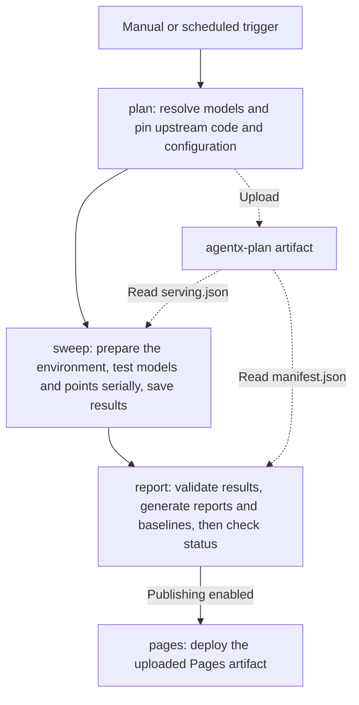

# AgentX CI Guide

[中文](README.zh.md)

This guide covers the AKLR AgentX performance pipeline, local CLI, model configuration, and GitHub runner registration.

## 1. GitHub Runner Pipeline

[agentx-ci.yaml](../../.github/workflows/agentx-ci.yaml) contains four jobs:



Solid arrows show job execution order; dashed arrows show artifact uploads and reads. `agentx-plan` is uploaded once and read by both sweep and report. The report job waits for plan and sweep to finish; it can use the plan to report failures even when sweep fails.

A model's baseline is updated only when all points complete successfully and the source tree is clean. Failed, incomplete, dirty, or unknown-source runs do not update the baseline.

## 2. CLI Commands

### 2.1 Environment and Entry Point

Run the commands in this section from `benchmarks/agentx` in the repository.

```bash
# Start at the repository root
cd benchmarks/agentx
python3 -m pip install pyyaml==6.0.3
python3 -m agentx_bench pipeline --help
```

| Command | Purpose |
| --- | --- |
| `pipeline` | Run one model through plan → sweep → report → cleanup |
| `plan` | Resolve one or more models and generate a manifest for report validation |
| `sweep` | Install the current checkout in Docker and execute a serving plan |
| `resolve` | Resolve one model's serving configuration for inspection or use with a local InferenceX checkout |
| `report` | Render a single result; with `--plan`, validate the plan, build a site, and manage baselines |

### 2.2 Run the Pipeline

`pipeline` tests one model at a time and requires `--model <id>`. The example assumes that pinned model weights are already cached in `/data/hf/hub`; see section 4 for runner setup.

```bash
python3 -m agentx_bench pipeline \
  --model glm52-fp4 \
  --hub /data/hf/hub \
  --out /data/agentx/run-001
```

`--out` must be a new directory that does not exist yet. When the run finishes, open `/data/agentx/run-001/site/index.html`.

The pipeline produces this directory structure:

```text
<out>/
├── plan/
│   ├── manifest.json
│   └── models/<model-id>/serving.json
├── results/models/<model-id>/
│   ├── install.log
│   ├── prepare_traces.log
│   ├── results.json
│   └── attempts/<attempt-id>/points/<exp-name>/
│       ├── server.log
│       ├── client.log
│       └── ...
├── site/
│   ├── index.html
│   ├── manifest.json
│   └── models/<model-id>/
│       ├── index.html
│       ├── results.json
│       ├── report.json
│       └── baseline-live.json or baseline-pareto.json
├── work/                  # Temporary resolution, runtime, and trace caches
└── cache/                 # Temporary build and other caches
```

Logs appear only after the corresponding stage has started. The default `work/` and `cache/` directories are removed when the local pipeline finishes. Directories supplied explicitly with `--work` and `--cache` are retained.

Common options:

| Option | Description |
| --- | --- |
| `--config` | Custom YAML path; defaults to `agentx.yaml` in this directory |
| `--model` | Required: exactly one enabled model ID; `all` and comma-separated lists are not accepted |
| `--inferencex-ref` | Override the InferenceX branch, tag, or commit SHA |
| `--run-image` | Set the execution image during planning; pinning a digest is recommended |
| `--arms` / `--points` | Smoke filters under the full-grid policy; `--points` uses `ARM:CONC,ARM:CONC` |
| `--duration` | Override DURATION per point in seconds; excludes the run from baseline promotion |
| `--model-path` | Use a model directory visible inside the container; does not add a mount and excludes the run from baseline promotion |
| `--git-dir` | Checkout used to generate AKLR commit history in the report; defaults to this repository |

### 2.3 Run Individual Stages

First, resolve the plan without running a GPU workload:

```bash
python3 -m agentx_bench plan \
  --models glm52-fp4 \
  --run-id staged-001 \
  --work /data/agentx/staged-work \
  --out /data/agentx/staged-001/plan

python3 -m json.tool /data/agentx/staged-001/plan/manifest.json
```

Once the model status is `resolved`, run it in Docker:

```bash
python3 -m agentx_bench sweep \
  --serving /data/agentx/staged-001/plan/models/glm52-fp4/serving.json \
  --hub /data/hf/hub \
  --run-id staged-001 \
  --work /data/agentx/staged-work/sweep-glm52 \
  --cache /data/agentx/staged-cache \
  --out /data/agentx/staged-001/results/models/glm52-fp4
```

Finally, generate the index and model reports:

```bash
python3 -m agentx_bench report \
  --plan /data/agentx/staged-001/plan/manifest.json \
  --results /data/agentx/staged-001/results \
  --baseline-dir /data/agentx/run-001/site \
  --out /data/agentx/staged-001/site
```

Omit `--baseline-dir` when no baseline exists yet. `plan --models` supports the multi-model plans used by CI; this local example runs one model. The report's `--results` points to the root containing `models/`, while sweep's `--out` points to the specific model directory. Planning and execution must use the same `--run-id`.

## 3. Configuration

### 3.1 agentx.yaml Fields

The current configuration is:

```yaml
inferencex:
  repo: SemiAnalysisAI/InferenceX
  ref: main
models:
  glm52-fp4:
    enabled: true
    display_name: GLM-5.2 MXFP4
    inferencex:
      config_key: glm5.2-fp4-mi355x-sglang-agentic-mtp
      expect:
        config_file: inferencex-e2e/configs/amd-master.yaml
        recipe: inferencex-e2e/benchmarks/single_node/srt-slurm-recipes/glm5.2/sglang/mi355x-fp4-mtp/agentic.yaml
        model: amd/GLM-5.2-MXFP4
        model-prefix: glm5.2
        framework: sglang
        precision: mxfp4
        runner_pattern: mi355x
    weights:
      repo: amd/GLM-5.2-MXFP4
      revision: 386bd0e4ec821f7b07975701cec3c3b953a5576a
report:
  repo_url: https://github.com/AMD-AGI/AKLR
advisory_env:
  AKLR_SGLANG_PLUGIN: '1'
```

| Field | Description |
| --- | --- |
| `inferencex.repo` | Default upstream GitHub repository, in `owner/repo` form |
| `inferencex.ref` | Default upstream branch, tag, or SHA; planning resolves it to a commit; `--inferencex-ref` takes precedence |
| `models.<id>` | Model identity for CLI selection, directories, and separate baselines; 1–64 lowercase letters, digits, `_`, or `-`, starting with a letter or digit; `all` is reserved |
| `enabled` | Boolean, default `true`; disabled models cannot be selected even by explicit ID |
| `display_name` | Name shown in reports; defaults to the model ID |
| Model-level `inferencex.repo` / `ref` | Override the global upstream repository and ref |
| `inferencex.config_key` | Entry key in the upstream master configuration, defining the model matrix and recipe binding |
| `inferencex.expect.config_file` | Upstream configuration path, relative to the InferenceX repository root |
| `inferencex.expect.recipe` | Expected recipe path, relative to the InferenceX repository root; checked for existence during resolution |
| `inferencex.expect.model` | Required exact match for the upstream model name |
| `inferencex.expect.model-prefix` | Required upstream model prefix; also used for client trace selection |
| `inferencex.expect.framework` | Required upstream framework; the current local launcher uses SGLang |
| `inferencex.expect.precision` | Expected weight precision; generic upstream `fp4` is normalized to `mxfp4` or `nvfp4` using the model name |
| `inferencex.expect.runner_pattern` | Regular expression matching the upstream runner field; not this repository's GitHub runner label |
| `weights.repo` | Hugging Face model repository, configured separately for each model |
| `weights.revision` | Pinned weight commit SHA, used for both the snapshot path and server revision |
| `advisory_env` | Global additional server environment; currently enables the AKLR SGLang plugin; use string values |
| `models.<id>.advisory_env` | Model-level environment overriding global values; conflicts with environment keys already set by the upstream recipe are rejected |
| `report.repo_url` | Repository URL used for AKLR commit and history links; not the Pages site URL |

The server inherits defaults from the planned image's verified Docker `Config.Env`. The allowed
infrastructure environment (cache paths, certificates, proxies, and similar settings) overrides those
defaults, and the point's explicit `launch.env` overrides both. Arbitrary tuning variables in the
launcher's environment are not inherited. Image metadata is read and validated once before GPU
inspection; missing or malformed environment metadata fails the run before serving starts.

Results record the image defaults, with credential-like values redacted, under
`run.execution.server_environment`. Its canonical `defaults_sha256` and the
`paired-aklr-image-env-v2` policy participate in measurement identity, separating these runs from
older runs that filtered out image defaults. Both AKLR modes use the same defaults and differ only
in their explicit AKLR switches. Trace preparation, client package inspection, and the AgentX client
retain their separate infrastructure allowlist and planned client environment; they do not inherit
the server's image defaults or `advisory_env`.

The model hub's `refs/main` must contain exactly the pinned revision, without a trailing newline or
whitespace. Hugging Face uses that content verbatim for the client's offline tokenizer; the runtime
checks it before preparing traces or starting the server.

### 3.2 Add a Model

Confirm the model's `config_key`, configuration path, recipe, model name, precision, and runner at the target InferenceX ref. The executor currently targets single-node SGLang; changing `framework` alone does not add support for another serving framework.

Add a separate entry under the existing `models:` mapping. Replace the angle-bracket placeholders below with real values before use:

```yaml
  new-model:
    enabled: true
    display_name: New Model
    inferencex:
      # Omit repo/ref to inherit the global values
      config_key: <upstream configuration entry key>
      expect:
        config_file: inferencex-e2e/configs/amd-master.yaml
        recipe: <recipe path relative to the upstream repository root>
        model: <upstream model name>
        model-prefix: <upstream model prefix>
        framework: sglang
        precision: <expected precision, such as bf16 or mxfp4>
        runner_pattern: mi355x
    weights:
      repo: <Hugging Face owner/model>
      revision: <pinned 40-character weight commit SHA>
```

Validate the model in this order:

1. Run `plan --models new-model --work /data/agentx/new-work --out /data/agentx/new-plan`. Check that the manifest status is `resolved`, and inspect the generated GPU count, arms, concurrency, weights, and image in the serving plan.
2. Prepare the model's pinned snapshot and tokenizer `refs/main` in the shared hub, and configure the runner as described in section 4. Confirm that the runner has enough resources for the model and the recipe's host-memory requirements.
3. Choose a generated point and run a smoke pipeline using the options in section 2. Inspect `server.log`, `client.log`, and any recorded errors.
4. Commit the completed configuration and source before running a formal full measurement. Default scheduled CI and `plan --models all` include the enabled model; use `pipeline --model new-model` to test it individually on a local host.

## 4. Register a Runner

### 4.1 Run the Registration Script

In the target GitHub repository, open **Settings → Actions → Runners → New self-hosted runner** to obtain a temporary registration token. Pass it through the `RUNNER_TOKEN` environment variable.

```bash
# Run from the repository root; token input is not echoed
read -r -s -p 'Runner registration token: ' RUNNER_TOKEN
echo
export RUNNER_TOKEN

bash scripts/agentx/register_runner.sh \
  --repo AMD-AGI/AKLR \
  --label agentx-mi355x \
  --dir /opt/agentx-runner \
  --name "$(hostname -s)-agentx" \
  --hf-hub-dir /data/hf/hub

unset RUNNER_TOKEN
```

| Option | Default | Purpose |
| --- | --- | --- |
| `--repo` | `AMD-AGI/AKLR` | Target repository; the token must come from this repository |
| `--label` | `agentx-mi355x` | Custom label used by the workflow to schedule jobs |
| `--version` | `2.338.2` | GitHub Actions runner version to download; can be overridden |
| `--dir` | `/opt/agentx-runner` | Runner installation directory |
| `--name` | `<hostname>-agentx` | Runner name displayed on GitHub |
| `--hf-hub-dir` | None | Optional: check that the directory exists and print the next configuration step |

The script downloads the Linux x64 runner, registers it with `config.sh --unattended --replace`, and installs and starts the service with `svc.sh install/start`. `--replace` replaces a runner registration with the same name in the target repository; choose a distinct name for a new host.

### 4.2 Configure Repository Variables and Verify

Set these variables under **Settings → Secrets and variables → Actions → Variables**:

| Repository variable | Required | Value and purpose |
| --- | --- | --- |
| `AGENTX_HF_HUB_DIR` | Yes | Absolute path to the weights hub on the runner, such as `/data/hf/hub` |
| `AGENTX_RUNNER_LABEL` | For a custom label | Must match registration's `--label`; defaults to `agentx-mi355x` |
| `AGENTX_SCHEDULE_ENABLED` | To enable scheduled runs | Set to the string `true`; otherwise use manual triggers |
| `AGENTX_PAGES_URL` | For a custom site URL | Root URL for reading the previous site and baselines; defaults to `https://<owner>.github.io/<repo>` |

To publish reports, set the build and deployment source to **GitHub Actions** under **Settings → Pages**. Ensure that the `github-pages` environment allows deployments from the target branch.

Confirm that the runner appears Online / Idle on GitHub, then check the service on the host:

```bash
cd /opt/agentx-runner
sudo ./svc.sh status
```
