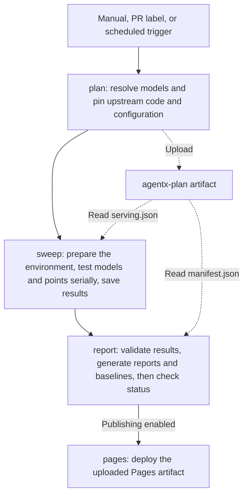

# AgentX CI Guide

[中文](README.zh.md)

This guide covers the AKLR AgentX performance pipeline, GitHub triggers, local CLI, model configuration, and GitHub runner registration.

## 1. GitHub Runner Pipeline

[agentx-ci.yaml](../../.github/workflows/agentx-ci.yaml) contains four jobs:



Solid arrows show job execution order; dashed arrows show artifact uploads and reads. `agentx-plan` is uploaded once and read by both sweep and report. The report job waits for plan and sweep to finish; it can use the plan to report failures even when sweep fails.

A model target's baseline is updated only when all points complete a formal measurement successfully and the source tree is clean. Failed, incomplete, dirty, or unknown-source runs do not update the baseline.

### 1.1 Trigger with a GitHub Runner

Open the [AKLR-agentx-ci workflow](https://github.com/AMD-AGI/AKLR/actions/workflows/agentx-ci.yaml), click **Run workflow**, select an AKLR branch, fill in the parameters below, and click **Run workflow** in the form. Sign in with a GitHub account that can run workflows in this repository; see section 4 for runner setup.

The form has **7 workflow inputs**, plus GitHub's **Branch / Use workflow from** selector: 8 settings in total. All 7 inputs can be left at their defaults.

| Setting / input | Default | Meaning | CLI equivalent |
| --- | --- | --- | --- |
| Branch / Use workflow from | Default branch, usually `main` | Select the **AKLR** workflow, source, and configuration revision | `gh workflow run --ref`; the local CLI uses the current checkout |
| `models` | `all` | Enabled model IDs, separated by commas, such as `glm52-fp4`; `all` selects every enabled model | `plan --models`; local `pipeline --model` accepts one ID |
| `targets` | `all` | Enabled target IDs within the selected models, such as `mi355x`; comma-separated targets run serially in plan order | `plan --targets`; local `pipeline --target` accepts one ID |
| `inferencex_ref` | Empty | Override the **InferenceX** branch, tag, or SHA that supplies the grid, serving configuration, and client; empty uses the configured ref, currently `main` | `--inferencex-ref` |
| `arms` | `all` | Generated serving scheme IDs, such as `tp8-ep1-none-spec-mtp`, separated by commas; `all` applies no arm filter | `--arms` |
| `points` | Empty | Exact `ARM:CONC` points, such as `tp8-ep1-none-spec-mtp:1`, separated by commas; empty adds no point filter and still respects `arms` | `--points` |
| `duration_s` | Empty | Override each point's measurement duration in seconds; a positive integer such as `60`; empty inherits the duration in the upstream generated plan, currently `3600` seconds for AgentX | **`--duration`** |
| `publish` | `false`, unchecked | Deploy the report to GitHub Pages when checked; generated result and report artifacts are still uploaded when unchecked | Local `pipeline` generates `site/` and has no automatic publishing flag |

Branch selects the AKLR revision; `inferencex_ref` selects the upstream InferenceX revision. The selected target's `runner_label` in `agentx.yaml` determines the execution runner. Set `targets` to a target ID such as `mi355x`. The current `mi355x` target is configured for 8 MI355X GPUs, with the count recorded in `hardware.gpu_count`; the upstream scheme determines how many GPUs each point uses.

When configuring a smoke run:

- If `arms` differs from `all`, `points` is supplied, or `duration_s` is supplied, the final selection must contain **exactly one model / target combination**. Set both `models` and `targets` explicitly.
- `ARM` and `CONC` come from `points[].arm` and `points[].conc` in the generated `serving.json`. For example, `tp8-ep1-none-spec-mtp:1` selects that scheme at concurrency 1; the concurrency must already exist in the grid.
- Both `arms` and `points` apply: every requested point must belong to the selected arms. Unknown IDs cause errors. Separate list entries with commas and no spaces.
- Each point is measured with AKLR off and on. `duration_s=60` applies separately to both measurements; server startup, warmup, and other work add time. For formal measurements, leave `duration_s` empty and omit `--duration` in the local CLI. Any explicit duration override, including `3600`, excludes the run from baseline promotion.
- For a full-grid run, keep `arms=all` and leave `points` and `duration_s` empty. `publish` controls deployment for manual runs. PR labels and scheduled runs have their own defaults, described below; they do not read the manual form's inputs.

Read `models/<model-id>/targets/<target-id>/serving.json` from an existing run's `agentx-plan` artifact, or generate a plan locally with `plan`. To list valid points, run this from the extracted artifact's root:

```bash
jq -r '.points[] | "\(.arm):\(.conc)"' \
  models/glm52-fp4/targets/mi355x/serving.json
```

Use the same AKLR configuration and InferenceX ref when choosing IDs and triggering the run. The following example assumes that the generated grid includes `tp8-ep1-none-spec-mtp:1`. It runs that point for 60 seconds per measurement without publishing to Pages.

Trigger the same GitHub workflow from a terminal:

```bash
gh workflow run agentx-ci.yaml --repo AMD-AGI/AKLR \
  --ref main \
  -f models=glm52-fp4 \
  -f targets=mi355x \
  -f inferencex_ref=main \
  -f arms=all \
  -f points=tp8-ep1-none-spec-mtp:1 \
  -f duration_s=60 \
  -F publish=false
```

Replace `--ref main` with the AKLR branch to test. To pin upstream code, replace `main` in `inferencex_ref=main` with the required tag or commit SHA.

For the corresponding local run, use the same AKLR checkout and InferenceX ref on a host with the required GPUs, Docker, and model cache (see section 2 for environment setup):

```bash
# Start at the repository root; --out must not already exist
cd benchmarks/agentx
python3 -m agentx_bench pipeline \
  --model glm52-fp4 \
  --target mi355x \
  --inferencex-ref main \
  --arms all \
  --points tp8-ep1-none-spec-mtp:1 \
  --duration 60 \
  --hub /data/hf/hub \
  --out /data/agentx/smoke-001
```

The GitHub workflow uses a runner with the matching label and reads the model cache path from the `AGENTX_HF_HUB_DIR` repository variable. The local CLI runs on the current host and takes the cache path from `--hub`. The GitHub run page provides `agentx-plan`, generated `agentx-results-*`, and `agentx-site` artifacts. Local results and reports are saved under `--out`, with `site/index.html` as the report entry point. Complete section 4.2 before publishing to Pages.

### 1.2 Trigger with a PR Label

For a PR from a branch in this repository targeting `main`, add **`ci:agentx-mi355x`** under **Labels** on the PR page to trigger AgentX CI. **Draft PRs are supported.**

- Opening a PR, pushing new commits to it, or reopening it triggers a run when it carries this label. A label event starts AgentX tests only when the newly added label is `ci:agentx-mi355x`; adding other labels is skipped.
- Pushing new commits while keeping the label triggers a new run. AgentX jobs that are already running are not automatically canceled.
- `ci:agentx-mi355x` is a **PR label**; `agentx-mi355x` is a **GitHub Actions runner label**. PR runs select enabled model targets whose configuration has `runner_label: agentx-mi355x`, currently the `mi355x` target with 8 GPUs.

PR runs test GitHub's default PR merge commit, execute `plan → sweep → report`, and save plan, result, and report artifacts without deploying to GitHub Pages.

The label trigger has no input parameters. It selects all enabled models and targets assigned to `agentx-mi355x`, uses the configured InferenceX ref, and tests **upstream InferenceX Pareto frontier points for 600 seconds each**, separately with AKLR off and on. These duration overrides do not promote a formal baseline.

For each target, planning matches its model prefix to the official InferenceX model catalog, fetches the published measurements, and selects the frontier within the same model, MI355X hardware, framework, precision, and AgentX workload. A single arm can contribute several concurrency points. The selected points must match the resolved recipe fingerprints, concurrency, topology, and upstream image exactly; runtime image overrides are recorded separately in `serving.json`. Missing upstream measurements or mismatches fail that target's plan; the planner does not substitute a full-grid run. Each target saves `upstream-snapshot.json` and `selection.json` alongside `serving.json` in `agentx-plan`.

To inspect the same selection locally, generate a plan without starting a GPU workload:

```bash
python3 -m agentx_bench plan \
  --models all --targets all --runner-label agentx-mi355x \
  --point-policy inferencex-pareto \
  --inferencex-model auto --inferencex-hardware mi355x \
  --duration 600 \
  --work /data/agentx/pr-work --out /data/agentx/pr-plan
```

Run this from `benchmarks/agentx` and choose a fresh plan output directory. In `plan`, `--inferencex-model auto` looks up each target's model independently and supports multiple targets with a common duration. An explicit model name, result snapshot, or upstream run remains limited to one target. To choose models, exact points, or duration through GitHub's manual form, use **Run workflow** as described in section 1.1 and select the PR branch. The seven-input form uses the full-grid policy with optional smoke filters; it does not expose the Pareto policy.

### 1.3 Scheduled Runs

Set the repository variable `AGENTX_SCHEDULE_ENABLED` to `true` to enable the Friday 10:17 UTC schedule. Scheduled runs use the default branch and the configured InferenceX ref.

| Trigger | Model / target scope | Points | Duration per AKLR off/on measurement | Publish Pages |
| --- | --- | --- | --- | --- |
| PR label `ci:agentx-mi355x` | All enabled targets assigned to `agentx-mi355x` | Upstream Pareto frontier | 600 seconds | No |
| Schedule | All enabled targets assigned to `agentx-mi355x` | Full grid | 3600 seconds | Yes |

The schedule passes `--require-recipe-duration 3600`: planning verifies that every selected point inherits 3600 seconds from InferenceX. A different upstream duration fails that target's plan for review. This check does not apply a smoke duration override, so successful complete runs remain eligible for formal baseline promotion. Pages deployment still requires the setup in section 4.2.

## 2. CLI Commands

### 2.1 Environment and Entry Point

Run the commands in this section from `benchmarks/agentx` in the repository.

```bash
# Start at the repository root
cd benchmarks/agentx
python3 -m pip install pyyaml==6.0.3
python3 -m agentx_bench pipeline --help
```

| Command | Purpose |
| --- | --- |
| `pipeline` | Run one model target through plan → sweep → report → cleanup |
| `plan` | Resolve targets from one or more models and generate a manifest for report validation |
| `sweep` | Install the current checkout in Docker and execute a serving plan |
| `resolve` | Resolve one model's serving configuration for inspection or use with a local InferenceX checkout |
| `report` | Render a single result; with `--plan`, validate the plan, build a site, and manage baselines |

### 2.2 Run the Pipeline

`pipeline` tests one model target at a time and requires `--model <id>`. You can omit `--target` when the model has exactly one enabled target. The example assumes that pinned model weights are already cached in `/data/hf/hub`; see section 4 for runner setup.

```bash
python3 -m agentx_bench pipeline \
  --model glm52-fp4 \
  --target mi355x \
  --hub /data/hf/hub \
  --out /data/agentx/run-001
```

`--out` must be a new directory that does not exist yet. When the run finishes, open `/data/agentx/run-001/site/index.html`.

The pipeline produces this directory structure:

```text
<out>/
├── plan/
│   ├── manifest.json
│   └── models/<model-id>/targets/<target-id>/serving.json
├── results/models/<model-id>/targets/<target-id>/
│   ├── install.log
│   ├── prepare_traces.log
│   ├── results.json
│   └── attempts/<attempt-id>/<mode>/points/<exp-name>/
│       ├── server.log
│       ├── client.log
│       └── ...
├── site/
│   ├── index.html
│   ├── manifest.json
│   └── models/<model-id>/targets/<target-id>/
│       ├── index.html
│       ├── results.json
│       ├── report.json
│       └── baseline-live.json or baseline-pareto.json
├── work/                  # Temporary resolution, runtime, and trace caches
└── cache/                 # Temporary build and other caches
```

`<mode>` is `disabled` (AKLR off) or `enabled` (AKLR on). Logs appear only after the corresponding stage has started. The default `work/` and `cache/` directories are removed when the local pipeline finishes. Directories supplied explicitly with `--work` and `--cache` are retained.

Common options:

| Option | Description |
| --- | --- |
| `--config` | Custom YAML path; defaults to `agentx.yaml` in this directory |
| `--model` | Required: exactly one enabled model ID; `all` and comma-separated lists are not accepted |
| `--target` | Exactly one enabled target ID; optional only when the model has one enabled target |
| `--inferencex-ref` | Override the InferenceX branch, tag, or commit SHA |
| `--run-image` | Set the execution image during planning; pinning a digest is recommended |
| `--arms` / `--points` | Smoke filters under the full-grid policy; `--points` uses `ARM:CONC,ARM:CONC` |
| `--duration` | Override DURATION per point in seconds; excludes the run from baseline promotion |
| `--model-path` | Use a model directory visible inside the container; does not add a mount and excludes the run from baseline promotion |
| `--git-dir` | Checkout used to generate AKLR commit history in the report; defaults to this repository |

### 2.3 Run Individual Stages

First, resolve the plan without running a GPU workload:

```bash
python3 -m agentx_bench plan \
  --models glm52-fp4 \
  --targets mi355x \
  --run-id staged-001 \
  --work /data/agentx/staged-work \
  --out /data/agentx/staged-001/plan

python3 -m json.tool /data/agentx/staged-001/plan/manifest.json
```

Once the model's target status in the manifest is `resolved`, run that target in Docker:

```bash
python3 -m agentx_bench sweep \
  --serving /data/agentx/staged-001/plan/models/glm52-fp4/targets/mi355x/serving.json \
  --hub /data/hf/hub \
  --run-id staged-001 \
  --work /data/agentx/staged-work/sweep-glm52 \
  --cache /data/agentx/staged-cache \
  --out /data/agentx/staged-001/results/models/glm52-fp4/targets/mi355x
```

Finally, generate the index and model reports:

```bash
python3 -m agentx_bench report \
  --plan /data/agentx/staged-001/plan/manifest.json \
  --results /data/agentx/staged-001/results \
  --baseline-dir /data/agentx/run-001/site \
  --out /data/agentx/staged-001/site
```

Omit `--baseline-dir` when no baseline exists yet. `plan --models` and `--targets` support the multiple models and targets used by CI; this local example runs one model target. The report's `--results` points to the root containing `models/`, while sweep's `--out` points to the specific target directory. Planning and execution must use the same `--run-id`.

The `plan` command's `--runner-label agentx-mi355x` option further filters the selected models to enabled targets assigned to that runner label. Both PR label and scheduled triggers use this filter. `--require-recipe-duration` verifies inherited durations without overriding them and cannot be combined with `--duration`.

## 3. Configuration

### 3.1 agentx.yaml Fields

The current configuration is:

```yaml
inferencex:
  repo: SemiAnalysisAI/InferenceX
  ref: main
models:
  glm52-fp4:
    enabled: true
    display_name: GLM-5.2 MXFP4
    weights:
      repo: amd/GLM-5.2-MXFP4
      revision: 386bd0e4ec821f7b07975701cec3c3b953a5576a
    targets:
      mi355x:
        hardware:
          gpu_name_pattern: '\bMI355X\b'
          gpu_arch: gfx950
          gpu_count: 8
        runner_label: agentx-mi355x
        inferencex:
          config_key: glm5.2-fp4-mi355x-sglang-agentic-mtp
          expect:
            config_file: inferencex-e2e/configs/amd-master.yaml
            recipe: inferencex-e2e/benchmarks/single_node/srt-slurm-recipes/glm5.2/sglang/mi355x-fp4-mtp/agentic.yaml
            model: amd/GLM-5.2-MXFP4
            model-prefix: glm5.2
            framework: sglang
            precision: mxfp4
            runner_pattern: mi355x
report:
  repo_url: https://github.com/AMD-AGI/AKLR
advisory_env:
  AKLR_SGLANG_PLUGIN: '1'
```

| Field | Description |
| --- | --- |
| `inferencex.repo` | Default upstream GitHub repository, in `owner/repo` form |
| `inferencex.ref` | Default upstream branch, tag, or SHA; planning resolves it to a commit; `--inferencex-ref` takes precedence |
| `models.<id>` | Model identity for CLI selection, directories, and separate baselines; 1–64 lowercase letters, digits, `_`, or `-`, starting with a letter or digit; `all` is reserved |
| `enabled` | Model or target flag, default `true`; disabled entries cannot be selected even by explicit ID |
| `display_name` | Name shown in reports; defaults to the model ID |
| `models.<id>.targets.<target-id>` | Hardware target within a model, with the same ID rules as models; each target has separate directories and baselines, for example `mi355x` |
| Target-level `hardware.gpu_name_pattern` | Regular expression matching GPU names, such as `\bMI355X\b` |
| Target-level `hardware.gpu_arch` | Required GPU architecture, such as `gfx950` |
| Target-level `hardware.gpu_count` | GPU count on the target host; currently configured as `8` |
| Target-level `runner_label` | GitHub runner label used to schedule the target; must match registration's `--label` |
| Target-level `inferencex.repo` / `ref` | Override the global upstream repository and ref |
| Target-level `inferencex.config_key` | Entry key in the upstream master configuration, defining the target's matrix and recipe binding |
| `inferencex.expect.config_file` | Upstream configuration path, relative to the InferenceX repository root |
| `inferencex.expect.recipe` | Expected recipe path, relative to the InferenceX repository root; checked for existence during resolution |
| `inferencex.expect.model` | Required exact match for the upstream model name |
| `inferencex.expect.model-prefix` | Required upstream model prefix; also used for client trace selection |
| `inferencex.expect.framework` | Required upstream framework; the current local launcher uses SGLang |
| `inferencex.expect.precision` | Expected weight precision; generic upstream `fp4` is normalized to `mxfp4` or `nvfp4` using the model name |
| `inferencex.expect.runner_pattern` | Regular expression matching the upstream runner field; not this repository's GitHub runner label |
| `weights.repo` | Hugging Face model repository, configured separately for each model |
| `weights.revision` | Pinned weight commit SHA, used for both the snapshot path and server revision |
| `advisory_env` | Global additional server environment; currently enables the AKLR SGLang plugin; use string values |
| `models.<id>.advisory_env` | Model-level environment overriding global values; conflicts with environment keys already set by the upstream recipe are rejected |
| `models.<id>.targets.<target-id>.advisory_env` | Target-level environment overriding model and global values; conflicts with upstream recipe environment keys are also rejected |
| `report.repo_url` | Repository URL used for AKLR commit and history links; not the Pages site URL |

The `inferencex.expect.*` fields above belong to each target's `inferencex` mapping. Targets within a model share its `weights`.

The server inherits defaults from the planned image's verified Docker `Config.Env`. The allowed
infrastructure environment (cache paths, certificates, proxies, and similar settings) overrides those
defaults, and the point's explicit `launch.env` overrides both. Arbitrary tuning variables in the
launcher's environment are not inherited. Image metadata is read and validated once before GPU
inspection; missing or malformed environment metadata fails the run before serving starts.

Results record the image defaults, with credential-like values redacted, under
`run.execution.server_environment`. Its canonical `defaults_sha256` and the
`paired-aklr-image-env-v2` policy participate in measurement identity, separating these runs from
older runs that filtered out image defaults. Both AKLR modes use the same defaults and differ only
in their explicit AKLR switches. Trace preparation, client package inspection, and the AgentX client
retain their separate infrastructure allowlist and planned client environment; they do not inherit
the server's image defaults or `advisory_env`.

The model hub's `refs/main` must contain exactly the pinned revision, without a trailing newline or
whitespace. Hugging Face uses that content verbatim for the client's offline tokenizer; the runtime
checks it before preparing traces or starting the server.

### 3.2 Add a Model

Confirm the model's `config_key`, configuration path, recipe, model name, precision, and runner at the target InferenceX ref. The executor currently targets single-node SGLang; changing `framework` alone does not add support for another serving framework.

Add a separate entry under the existing `models:` mapping. Replace the angle-bracket placeholders below with real values before use:

```yaml
  new-model:
    enabled: true
    display_name: New Model
    weights:
      repo: <Hugging Face owner/model>
      revision: <pinned 40-character weight commit SHA>
    targets:
      mi355x:
        hardware:
          gpu_name_pattern: '\bMI355X\b'
          gpu_arch: gfx950
          gpu_count: 8
        runner_label: agentx-mi355x
        inferencex:
          # Omit repo/ref to inherit the global values
          config_key: <upstream configuration entry key>
          expect:
            config_file: inferencex-e2e/configs/amd-master.yaml
            recipe: <recipe path relative to the upstream repository root>
            model: <upstream model name>
            model-prefix: <upstream model prefix>
            framework: sglang
            precision: <expected precision, such as bf16 or mxfp4>
            runner_pattern: mi355x
```

Validate the model in this order:

1. Run `plan --models new-model --targets mi355x --work /data/agentx/new-work --out /data/agentx/new-plan`. Check that the target status in the manifest is `resolved`, and inspect the generated GPU count, arms, concurrency, weights, and image in the serving plan.
2. Prepare the model's pinned snapshot and tokenizer `refs/main` in the shared hub, and configure the runner as described in section 4. Confirm that the runner has enough resources for the model and the recipe's host-memory requirements.
3. Choose a generated point and run a smoke pipeline using the options in section 2. Inspect `server.log`, `client.log`, and any recorded errors.
4. Commit the completed configuration and source before running a formal full measurement. `plan --models all` includes the enabled model's targets; scheduled CI includes those assigned to `agentx-mi355x`. PR label runs also need matching published InferenceX measurements for Pareto selection. Use `pipeline --model new-model --target mi355x` to test it individually on a local host.

## 4. Register a Runner

### 4.1 Run the Registration Script

In the target GitHub repository, open **Settings → Actions → Runners → New self-hosted runner** to obtain a temporary registration token. Pass it through the `RUNNER_TOKEN` environment variable.

```bash
# Run from the repository root; token input is not echoed
read -r -s -p 'Runner registration token: ' RUNNER_TOKEN
echo
export RUNNER_TOKEN

bash scripts/agentx/register_runner.sh \
  --repo AMD-AGI/AKLR \
  --label agentx-mi355x \
  --dir /opt/agentx-runner \
  --name "$(hostname -s)-agentx" \
  --hf-hub-dir /data/hf/hub

unset RUNNER_TOKEN
```

| Option | Default | Purpose |
| --- | --- | --- |
| `--repo` | `AMD-AGI/AKLR` | Target repository; the token must come from this repository |
| `--label` | `agentx-mi355x` | Custom label used by the workflow to schedule jobs |
| `--version` | `2.338.2` | GitHub Actions runner version to download; can be overridden |
| `--dir` | `/opt/agentx-runner` | Runner installation directory |
| `--name` | `<hostname>-agentx` | Runner name displayed on GitHub |
| `--hf-hub-dir` | None | Optional: check that the directory exists and print the next configuration step |

The script downloads the Linux x64 runner, registers it with `config.sh --unattended --replace`, and installs and starts the service with `svc.sh install/start`. `--replace` replaces a runner registration with the same name in the target repository; choose a distinct name for a new host.

### 4.2 Configure Repository Variables and Verify

Set these variables under **Settings → Secrets and variables → Actions → Variables**:

| Repository variable | Required | Value and purpose |
| --- | --- | --- |
| `AGENTX_HF_HUB_DIR` | Yes | Absolute path to the weights hub on the runner, such as `/data/hf/hub` |
| `AGENTX_SCHEDULE_ENABLED` | To enable scheduled runs | Set to the string `true`; controls scheduled triggers only, independently of manual or PR label triggers |
| `AGENTX_PAGES_URL` | For a custom site URL | Root URL for reading the previous site and baselines; defaults to `https://<owner>.github.io/<repo>` |

The selected target's `runner_label` in `agentx.yaml` must match registration's `--label`; both are `agentx-mi355x` in this example.

To publish reports, set the build and deployment source to **GitHub Actions** under **Settings → Pages**. Ensure that the `github-pages` environment allows deployments from the target branch.

Confirm that the runner appears Online / Idle on GitHub, then check the service on the host:

```bash
cd /opt/agentx-runner
sudo ./svc.sh status
```
