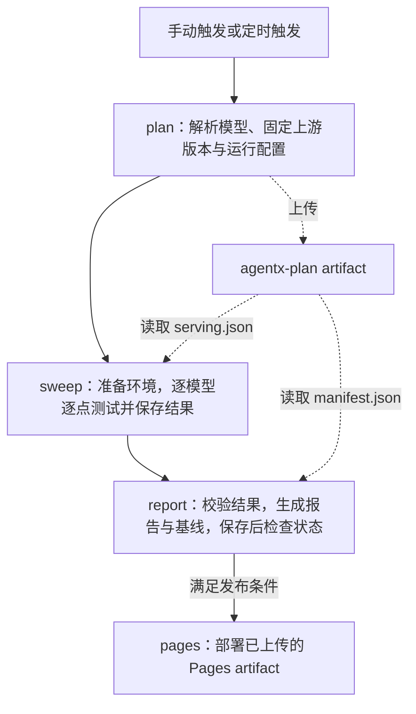

# AgentX CI 使用说明

本文介绍 AKLR 的 AgentX 性能测试流程、本地 CLI、模型配置和 GitHub runner 注册。

## 1. Github Runner Pipeline 介绍

[agentx-ci.yaml](../../.github/workflows/agentx-ci.yaml) 包含四个 job：



实线表示 job 的执行顺序；虚线表示 artifact 的上传或读取。`agentx-plan` 只上传一次，分别供 sweep 和 report 读取。report 等待 plan 和 sweep 结束后运行；sweep 失败时仍可依据计划生成失败报告。

所有点成功完成测量且源码为干净状态才会更新该模型的基线。失败、部分完成、dirty 或源码状态未知的运行不会更新基线。

## 2. CLI 命令介绍

### 2.1 准备环境与命令入口

本节命令在仓库的 `benchmarks/agentx` 执行。

```bash
# 从仓库根目录开始
cd benchmarks/agentx
python3 -m pip install pyyaml==6.0.3
python3 -m agentx_bench pipeline --help
```

| 子命令 | 用途 |
| --- | --- |
| `pipeline` | 单模型一键 plan → sweep → report → 清理 |
| `plan` | 解析一个或多个模型，生成可供 report 校验的 manifest |
| `sweep` | 在 Docker 中安装当前 checkout 并执行 serving 计划 |
| `resolve` | 只解析单模型的 serving 配置，便于检查或使用本地 InferenceX checkout |
| `report` | 渲染单个结果；加 `--plan` 时校验计划、生成站点并管理基线 |

### 2.2 使用 pipeline 一键测试

`pipeline` 每次只测试一个模型，必须使用 `--model <id>`。以下示例假定固定版本权重已经放在 `/data/hf/hub`；准备方式见第 4 节。

```bash
python3 -m agentx_bench pipeline \
  --model glm52-fp4 \
  --hub /data/hf/hub \
  --out /data/agentx/run-001
```

`--out` 必须是尚不存在的新目录。完成后打开 `/data/agentx/run-001/site/index.html`。

`pipeline` 输出目录结构如下。

```text
<out>/
├── plan/
│   ├── manifest.json
│   └── models/<model-id>/serving.json
├── results/models/<model-id>/
│   ├── install.log
│   ├── prepare_traces.log
│   ├── results.json
│   └── attempts/<attempt-id>/points/<exp-name>/
│       ├── server.log
│       ├── client.log
│       └── ...
├── site/
│   ├── index.html
│   ├── manifest.json
│   └── models/<model-id>/
│       ├── index.html
│       ├── results.json
│       ├── report.json
│       └── baseline-live.json 或 baseline-pareto.json
├── work/                  # 默认临时解析、运行时与 trace 缓存
└── cache/                 # 默认临时编译等缓存
```

日志只在执行到相应阶段后出现。默认 `work/`、`cache/` 在本地 pipeline 结束后清理；显式传入 `--work`、`--cache` 的目录保留。

常用参数：

| 参数 | 说明 |
| --- | --- |
| `--config` | 自定义 YAML 路径；默认使用本目录的 `agentx.yaml` |
| `--model` | 必填，恰好一个已启用模型 ID；不接受 `all` 或逗号分隔列表 |
| `--inferencex-ref` | 覆盖 InferenceX 分支、tag 或 commit SHA |
| `--run-image` | 在计划阶段指定执行镜像，建议固定 digest |
| `--arms` / `--points` | 全量策略下的 smoke 过滤；`--points` 格式为 `ARM:CONC,ARM:CONC` |
| `--duration` | 每点 DURATION 覆盖，单位秒；设定后不晋升正式基线 |
| `--model-path` | 使用容器内可见的本地模型目录；不会自动新增挂载，且不晋升正式基线 |
| `--git-dir` | 生成报告中 AKLR 提交历史所用的 checkout；默认本仓库 |

### 2.3 分阶段测试

先解析计划，不运行 GPU：

```bash
python3 -m agentx_bench plan \
  --models glm52-fp4 \
  --run-id staged-001 \
  --work /data/agentx/staged-work \
  --out /data/agentx/staged-001/plan

python3 -m json.tool /data/agentx/staged-001/plan/manifest.json
```

确认模型状态为 `resolved` 后，在 Docker 中运行该模型：

```bash
python3 -m agentx_bench sweep \
  --serving /data/agentx/staged-001/plan/models/glm52-fp4/serving.json \
  --hub /data/hf/hub \
  --run-id staged-001 \
  --work /data/agentx/staged-work/sweep-glm52 \
  --cache /data/agentx/staged-cache \
  --out /data/agentx/staged-001/results/models/glm52-fp4
```

最后生成总览与模型报告：

```bash
python3 -m agentx_bench report \
  --plan /data/agentx/staged-001/plan/manifest.json \
  --results /data/agentx/staged-001/results \
  --baseline-dir /data/agentx/run-001/site \
  --out /data/agentx/staged-001/site
```

首次没有基线时省略 `--baseline-dir`。`plan` 可通过 `--models` 生成 CI 所需的多模型计划；本地分阶段示例只运行一个模型。`--results` 指向包含 `models/` 的根目录，sweep 的 `--out` 则指向具体模型目录。plan 与执行必须使用同一 `--run-id`。

## 3. 配置介绍

### 3.1 agentx.yaml 字段说明

当前配置如下：

```yaml
inferencex:
  repo: SemiAnalysisAI/InferenceX
  ref: main
models:
  glm52-fp4:
    enabled: true
    display_name: GLM-5.2 MXFP4
    inferencex:
      config_key: glm5.2-fp4-mi355x-sglang-agentic-mtp
      expect:
        config_file: inferencex-e2e/configs/amd-master.yaml
        recipe: inferencex-e2e/benchmarks/single_node/srt-slurm-recipes/glm5.2/sglang/mi355x-fp4-mtp/agentic.yaml
        model: amd/GLM-5.2-MXFP4
        model-prefix: glm5.2
        framework: sglang
        precision: mxfp4
        runner_pattern: mi355x
    weights:
      repo: amd/GLM-5.2-MXFP4
      revision: 386bd0e4ec821f7b07975701cec3c3b953a5576a
report:
  repo_url: https://github.com/AMD-AGI/AKLR
advisory_env:
  AKLR_SGLANG_PLUGIN: '1'
```

| 字段 | 说明 |
| --- | --- |
| `inferencex.repo` | 默认上游 GitHub 仓库，格式 `owner/repo` |
| `inferencex.ref` | 默认上游分支、tag 或 SHA；plan 将其固定到 commit；CLI `--inferencex-ref` 优先 |
| `models.<id>` | 模型独立标识，用于 CLI、目录与基线隔离；1–64 位小写字母、数字、`_`、`-`，首位须为字母或数字，`all` 保留 |
| `enabled` | 是否启用，布尔值，省略时为 `true`；禁用模型也不能通过显式 ID 选择 |
| `display_name` | 报告展示名，省略时使用模型 ID |
| `inferencex.repo` / `ref`（模型内） | 可覆盖全局上游仓库和 ref |
| `inferencex.config_key` | 上游 master 配置中的条目键，决定模型矩阵与 recipe 绑定 |
| `inferencex.expect.config_file` | 上游配置文件路径，相对 InferenceX 仓库根目录 |
| `inferencex.expect.recipe` | 预期 recipe 文件路径，相对 InferenceX 仓库根目录；解析时检查文件存在 |
| `inferencex.expect.model` | 要求上游条目的模型名称精确匹配 |
| `inferencex.expect.model-prefix` | 要求上游条目的模型前缀匹配，也用于客户端 trace 选择 |
| `inferencex.expect.framework` | 要求上游框架匹配；当前本地启动实现使用 SGLang |
| `inferencex.expect.precision` | 期望权重精度；上游通用 `fp4` 会结合模型名归一化为 `mxfp4` / `nvfp4` |
| `inferencex.expect.runner_pattern` | 匹配上游 runner 字段的正则表达式；它不是本仓库 GitHub runner 的标签 |
| `weights.repo` | Hugging Face 模型仓库，每个模型独立设置 |
| `weights.revision` | 固定的权重 commit SHA；同时用于 snapshot 路径和服务 revision |
| `advisory_env` | 全局服务器补充环境变量；当前用于启用 AKLR SGLang plugin，值建议写成字符串 |
| `models.<id>.advisory_env` | 模型级补充环境，覆盖同名全局值；若与上游 recipe 已设置的环境变量同名，会报冲突 |
| `report.repo_url` | 报告中 AKLR commit 与历史链接的仓库 URL；不是 Pages 站点地址 |

服务器继承计划镜像经 Docker 身份校验后的 `Config.Env` 默认值。允许的基础环境（缓存路径、
证书、代理等）覆盖镜像默认值，点的显式 `launch.env` 再覆盖两者；启动器环境中的任意调优
变量不会被继承。镜像元数据只读取并验证一次，先于 GPU 检查；环境元数据缺失或格式错误会
在启动服务前使运行失败。

结果在 `run.execution.server_environment` 中记录镜像默认值，并对凭据类值脱敏。
规范化的 `defaults_sha256` 与 `paired-aklr-image-env-v2` 策略进入测量身份，使这些结果与
过去过滤镜像默认值的运行分段。AKLR 两组使用相同默认值，仅显式 AKLR 开关不同。trace
准备、客户端包版本检查和 AgentX 客户端继续使用各自的基础环境白名单及计划客户端环境，
不会继承服务端镜像默认值或 `advisory_env`。

模型 hub 的 `refs/main` 必须恰好包含固定 revision，不能带末尾换行或空白。Hugging Face
会将该内容原样用于客户端离线 tokenizer；运行时会在准备 trace 和启动服务器前检查它。

### 3.2 新增模型

先在目标 InferenceX ref 中确认模型的 `config_key`、配置路径、recipe、模型名称、精度和 runner。当前执行器面向单机 SGLang；仅修改 `framework` 不能使其支持其他服务框架。

在已有 `models:` 下加入一个独立节点。下面是模板，尖括号内容必须替换为真实值，不能直接执行：

```yaml
  new-model:
    enabled: true
    display_name: New Model
    inferencex:
      # repo/ref 可省略，继承全局值
      config_key: <上游配置条目键>
      expect:
        config_file: inferencex-e2e/configs/amd-master.yaml
        recipe: <相对上游仓库根目录的 recipe 路径>
        model: <上游模型名称>
        model-prefix: <上游模型前缀>
        framework: sglang
        precision: <期望精度，例如 bf16 或 mxfp4>
        runner_pattern: mi355x
    weights:
      repo: <Hugging Face owner/model>
      revision: <固定的40位权重commit SHA>
```

按以下顺序验证：

1. 用 `plan --models new-model --work /data/agentx/new-work --out /data/agentx/new-plan` 解析，检查 manifest 为 `resolved`，并检查 serving 中生成的 GPU 数、arm、并发、权重和镜像。
2. 按第 4 节把新增模型的固定 snapshot 和 tokenizer 所需的 `refs/main` 准备到相同 hub；确认 runner 能容纳该模型及 recipe 的主机内存需求。
3. 从生成的点中选一个，按第 2 节运行 smoke pipeline；查看 `server.log`、`client.log` 和失败原因。
4. 完成配置后提交源码，再执行全量正式测量；默认定时 CI 和 `plan --models all` 会包含这个已启用模型；本地用 `pipeline --model new-model` 单独测试。

## 4. 注册 runner

### 4.1 执行注册脚本

在目标 GitHub 仓库进入 **Settings → Actions → Runners → New self-hosted runner**，获取临时 registration token。它通过 `RUNNER_TOKEN` 环境变量传入

```bash
# 从仓库根目录执行；交互输入不会显示 token
read -r -s -p 'Runner registration token: ' RUNNER_TOKEN
echo
export RUNNER_TOKEN

bash scripts/agentx/register_runner.sh \
  --repo AMD-AGI/AKLR \
  --label agentx-mi355x \
  --dir /opt/agentx-runner \
  --name "$(hostname -s)-agentx" \
  --hf-hub-dir /data/hf/hub

unset RUNNER_TOKEN
```

| 参数 | 默认值 | 作用 |
| --- | --- | --- |
| `--repo` | `AMD-AGI/AKLR` | 注册到哪个仓库；token 必须来自该仓库 |
| `--label` | `agentx-mi355x` | workflow 用来调度的自定义标签 |
| `--version` | `2.338.2` | 下载的 GitHub Actions runner 版本，可显式覆盖 |
| `--dir` | `/opt/agentx-runner` | runner 安装目录 |
| `--name` | `<hostname>-agentx` | GitHub 上显示的 runner 名称 |
| `--hf-hub-dir` | 无 | 可选：检查目录存在并打印后续变量设置提示 |

脚本会下载 Linux x64 runner、调用 `config.sh --unattended --replace` 注册，然后使用 `svc.sh install/start` 安装并启动服务。`--replace` 会替换目标仓库中同名 runner 的注册，给新主机选择独立名称。

### 4.2 设置仓库变量并验证

在 **Settings → Secrets and variables → Actions → Variables** 设置：

| 仓库变量 | 是否需要 | 值与用途 |
| --- | --- | --- |
| `AGENTX_HF_HUB_DIR` | 必填 | runner 上权重 hub 的绝对路径，例如 `/data/hf/hub` |
| `AGENTX_RUNNER_LABEL` | 自定义标签时填写 | 与注册时的 `--label` 一致；未设置则使用 `agentx-mi355x` |
| `AGENTX_SCHEDULE_ENABLED` | 启用定时时填写 | 字符串 `true`；否则只使用手动触发 |
| `AGENTX_PAGES_URL` | 自定义站点地址时填写 | 读取历史站点和基线的根 URL；默认 `https://<owner>.github.io/<repo>` |

需要发布报告时，在 **Settings → Pages** 将构建与部署来源设为 **GitHub Actions**，并确认 `github-pages` environment 的部署规则允许目标分支

确认 runner 在 GitHub 页面显示 Online / Idle，并在主机检查服务：

```bash
cd /opt/agentx-runner
sudo ./svc.sh status
```
